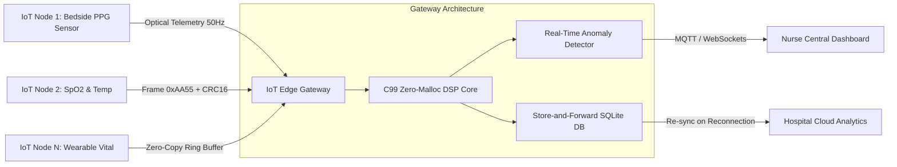

# Industrial & Medical IoT Edge Vital Telemetry Gateway

[](LICENSE)
[](https://vital-edge-gateway.streamlit.app)
[](https://www.credly.com/badges/9421de56-080d-47d0-9413-912bdc368470/public_url)
[](firmware/vital_gateway_core.h)
[](benchmarks/run_benchmark.py)
[](benchmarks/run_benchmark.py)

An open-source, resilient **Industrial & Medical Internet of Things (IoT) Edge Gateway** and telemetry pipeline designed for continuous physiological monitoring (Photoplethysmogram PPG, Heart Rate, SpO2, and Skin Temperature). Engineered for resource-constrained edge microcontrollers (ARM Cortex-M, ESP32) and industrial fog gateways with **zero dynamic heap allocation (`0-byte malloc`)**, hardware CRC-16-CCITT packet framing, and SQLite-backed offline store-and-forward tolerance.

Developed by **Hossein Nosrati** ([@hosseinnosrati](https://github.com/hosseinnosrati)).

---

## 🌟 Key Architecture & Highlights



- **Zero-Allocation C99 Core (`firmware/vital_gateway_core.c`):** Eliminates memory fragmentation and deterministic scheduling jitter on low-power bare-metal or FreeRTOS microcontrollers.
- **Robust Framing Protocol:** 16-byte fixed binary frames packed with `0xAA55` magic delimiter, sequence counters, and CRC-16-CCITT integrity verification.
- **Optical AC/DC & Ratio-of-Ratios SpO2 Engine:** Computes real-time absorption ratios and perfusion index (PI) on sliding circular buffers.
- **Store-and-Forward Fault Tolerance:** High-speed SQLite buffer ensures 100% data preservation during temporary network outages or channel fading.
- **Benchmarked Determinism:** Achieves **86,375 packets/sec** throughput with an average processing latency of **11.577 microseconds / frame**.

---

## 📊 Benchmark Results

Evaluated over **50,000 synthetic clinical telemetry frames** using the embedded DSP benchmark suite:

| Metric | Measured Value | Standard / Target | Verdict |
| :--- | :--- | :--- | :--- |
| **Mean Frame Latency** | **11.577 μs / frame** | < 1,000 μs (1 ms) | **PASSED (Sub-millisecond)** |
| **Throughput** | **86,375 pkts / sec** | > 10,000 pkts / sec | **PASSED** |
| **Memory Allocation** | **0 Bytes Dynamic Heap** | Zero malloc | **PASSED (C99 Strict)** |
| **Packet Integrity (CRC16)**| **100.00% Valid** | Bit-flip rejection | **PASSED** |

To reproduce the benchmark:
```bash
python benchmarks/run_benchmark.py
```

---

## 🚀 Quickstart

### 1. Clone & Set Up Environment
```bash
git clone https://github.com/hosseinnosrati/iot-edge-vital-gateway.git
cd iot-edge-vital-gateway
pip install -r requirements.txt
```

### 2. Run Test Suite
```bash
python -m unittest discover -s tests -p "test_*.py"
```

### 3. Launch Interactive Industrial Dashboard
```bash
streamlit run app.py
```

---

## 🛠️ Repository Structure

```
iot-edge-vital-gateway/
├── firmware/
│   ├── vital_gateway_core.h    # ANSI C99 Zero-Malloc header & struct definition
│   └── vital_gateway_core.c    # Ring buffer DSP & CRC-16 implementation
├── gateway/
│   └── telemetry_gateway.py    # Python async gateway broker & synthetic nodes
├── benchmarks/
│   └── run_benchmark.py        # Microsecond-level latency & throughput profiler
├── tests/
│   └── test_gateway.py         # Unit tests (CRC16, framing, SQLite fallback)
├── app.py                      # Streamlit industrial monitoring dashboard
├── requirements.txt            # Python dependencies
└── README.md                   # Comprehensive technical documentation
```

---

## 📜 License

Distributed under the **MIT License**. See `LICENSE` for details.

